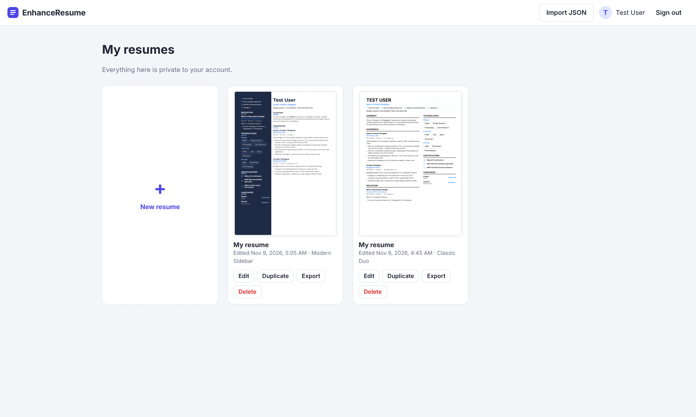
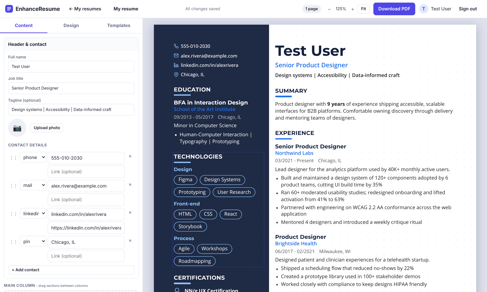
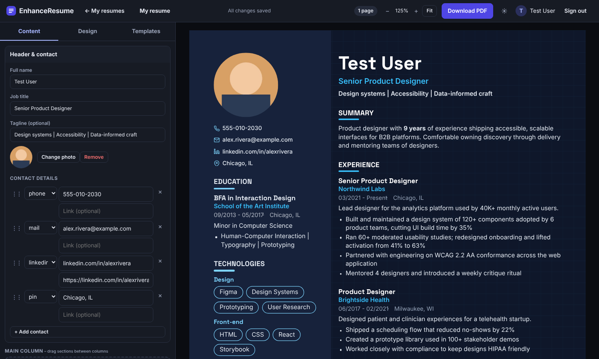
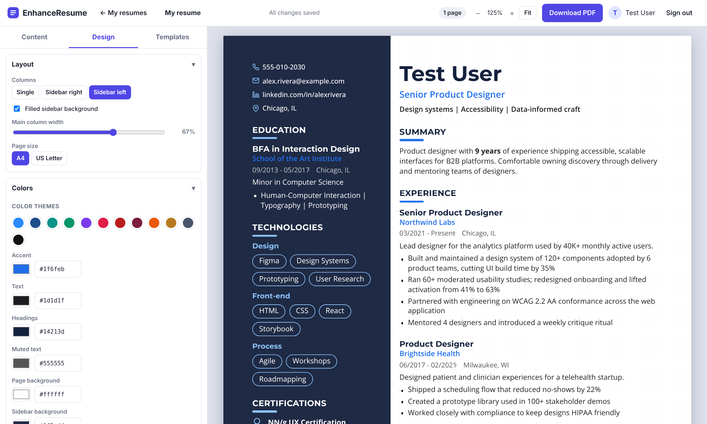
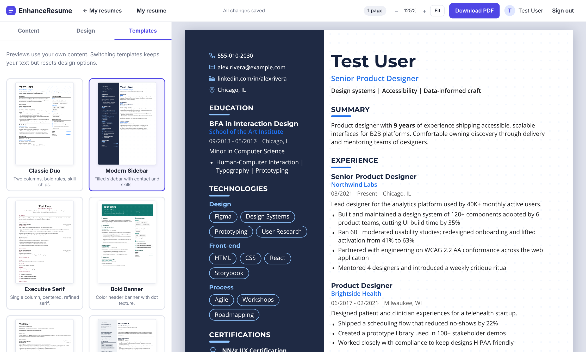

# EnhanceResume

A self-hosted, multi-tenant resume builder with live preview, drag & drop editing, 10 templates, full design control and server-side PDF export. Ships as a single Docker container.







| Design controls | Templates |
|---|---|
|  |  |

## Run

```bash
git clone https://github.com/amurikurthy/EnhanceResume.git && cd EnhanceResume
# edit NEWT_ID / NEWT_SECRET in docker-compose.yml (or remove the newt service), then:
docker compose up -d
```

The image `ghcr.io/amurikurthy/enhanceresume:latest` is built and published by GitHub Actions on every push to `main`. To build locally instead: `docker compose up -d --build`.

Common commands: `docker compose logs -f` (logs), `docker compose down` (stop; data is kept), `rm -rf ../data` after `docker compose down` (**deletes all data**), `docker compose pull && docker compose up -d` (update).

### docker-compose.yml

The app runs next to a [Newt](https://github.com/fosrl/newt) sidecar, which tunnels it to your Pangolin instance, so no host port is published. In Pangolin, point the resource at target `enhanceresume:3000`.

```yaml
name: enhanceresume
services:
  enhanceresume:
    image: ghcr.io/amurikurthy/enhanceresume:latest
    build: .                      # `docker compose up --build` builds locally instead of pulling
    container_name: enhanceresume
    restart: always
    environment:
      ALLOW_REGISTRATION: "true"  # "false" closes sign-ups
      COOKIE_SECURE: "true"       # served over HTTPS through the Pangolin tunnel
      TRUST_PROXY: "true"
      # --- Admin account (created/updated from these values on every start) ---
      ADMIN_EMAIL: ""             # e.g. admin@example.com
      ADMIN_PASSWORD: ""          # 8+ characters; leave empty if the admin signs in with SSO only
      # --- Authentik SSO (OpenID Connect); all three of ISSUER/CLIENT_ID/CLIENT_SECRET enable it ---
      PUBLIC_URL: ""              # public https URL of this app, e.g. https://resume.example.com
      OIDC_ISSUER: ""             # e.g. https://auth.example.com/application/o/enhanceresume/
      OIDC_CLIENT_ID: ""
      OIDC_CLIENT_SECRET: ""
      # OIDC_ADMIN_GROUP: "enhanceresume-admins"   # authentik group whose members become admins
      # OIDC_AUTO_CREATE: "true"                   # create accounts on first SSO login
      # DISABLE_PASSWORD_LOGIN: "false"            # "true" = SSO only (ADMIN_EMAIL keeps password login)
      MAX_RESUMES_PER_USER: "50"
      PDF_CONCURRENCY: "3"
    volumes:
      - ../data:/data             # SQLite database persists here (host folder next to the repo)
    shm_size: "512mb"             # Chromium needs shared memory for PDF rendering
    # ports:
    #   - "3000:3000"             # uncomment to reach it directly (use COOKIE_SECURE: "false" over plain http)

  enhanceresume-newt:
    image: fosrl/newt
    container_name: enhanceresume-newt
    restart: always
    environment:
      - PANGOLIN_ENDPOINT=https://pangolin.borderleaf.com
      - NEWT_ID=
      - NEWT_SECRET=
    extra_hosts:
      - "docker-host:host-gateway"

networks:
  default:
    name: enhanceresume
```

Create the site in Pangolin to get `NEWT_ID` and `NEWT_SECRET`. Data (SQLite database and session key) is stored in `../data` on the host (a `data` folder next to the repo folder), mounted at `/data`. The container runs as uid 1000, so create it first: `mkdir -p ../data && sudo chown 1000:1000 ../data`. Back up by copying that folder.

| Env var | Default | Purpose |
|---|---|---|
| `ALLOW_REGISTRATION` | `true` | set `false` to close sign-ups |
| `COOKIE_SECURE` | auto | `true` when served over HTTPS |
| `TRUST_PROXY` | – | `true` behind a reverse proxy (correct client IPs for rate limits) |
| `MAX_RESUMES_PER_USER` | `50` | per-account cap |
| `PDF_CONCURRENCY` | `3` | simultaneous Chromium renders |
| `ADMIN_EMAIL` / `ADMIN_PASSWORD` / `ADMIN_NAME` | – | administrator account, created on start; the password from the environment is re-applied on every start |
| `PUBLIC_URL` | – | public base URL; used to build the SSO redirect URI |
| `OIDC_ISSUER`, `OIDC_CLIENT_ID`, `OIDC_CLIENT_SECRET` | – | set all three to enable SSO |
| `OIDC_SCOPES` | `openid profile email` | add `groups` if your provider needs it for the groups claim |
| `OIDC_BUTTON_LABEL` | `Sign in with Authentik` | login button text |
| `OIDC_ADMIN_GROUP` | – | members of this group are administrators (synced at each login) |
| `OIDC_AUTO_CREATE` | `true` | create an account on first SSO login (`false` = only existing users) |
| `OIDC_TRUST_EMAIL` | `true` | link an SSO login to an existing local account with the same email |
| `DISABLE_PASSWORD_LOGIN` | `false` | SSO only; the `ADMIN_EMAIL` account keeps password login as a break-glass |
| `OIDC_REDIRECT_URI` | `PUBLIC_URL/api/auth/oidc/callback` | override the redirect URI |
| `SESSION_SECRET` | generated | signs the short-lived SSO state cookie; generated into `/data/session.key` if unset |

Without Docker: `npm ci && npm run build:assets && npm start` (Node ≥ 22.13, Chromium via `CHROME_PATH`).

## Admin account

Set `ADMIN_EMAIL` and `ADMIN_PASSWORD` in the environment. On every start the account is created (or promoted and its password reset to match the environment), so rotating the password is just a redeploy; existing sessions for it are revoked. That account cannot be disabled, demoted or deleted from the UI.

Admins get an **Admin** page in the top bar to see accounts (resume counts, last login), create users, reset passwords, disable/enable, promote/demote and delete accounts. Admins cannot read other users' resumes.

## Authentik SSO

EnhanceResume signs users in with OpenID Connect (authorization code flow + PKCE), so Authentik, or any OIDC provider, works.

1. In Authentik create an **OAuth2/OpenID Provider** (Applications → Providers): client type *Confidential*, redirect URI (strict) `https://<your-host>/api/auth/oidc/callback`, scopes `openid`, `email`, `profile`. Pick a **signing key** (RS256 is recommended; the default HS256 with the client secret also works).
2. Create an **Application** that uses the provider, with slug e.g. `enhanceresume`. Optionally create a group such as `enhanceresume-admins`.
3. Set the environment variables:
   ```yaml
   PUBLIC_URL: "https://resume.example.com"
   OIDC_ISSUER: "https://auth.example.com/application/o/enhanceresume/"
   OIDC_CLIENT_ID: "<client id>"
   OIDC_CLIENT_SECRET: "<client secret>"
   OIDC_ADMIN_GROUP: "enhanceresume-admins"   # optional
   ```
4. A **Sign in with Authentik** button appears on the login page. New users are created on first sign in; a user whose email matches an existing local account is linked to it. Set `DISABLE_PASSWORD_LOGIN: "true"` for SSO-only (the `ADMIN_EMAIL` account can still use "Local administrator sign in"). Signing out ends the EnhanceResume session only, not the Authentik one.

The group claim comes from Authentik's `profile` scope mapping; if admin promotion doesn't work, check that the user's ID token or userinfo contains `groups`.

## Features

- **Templates**: Classic Duo, Modern Sidebar, Executive Serif, Bold Banner, Minimal Plain, Compact Pro, Creative Teal, Elegant Rose, Midnight Dark, Charcoal Gold – previewed with your own content.
- **Dark mode**: the app UI follows your system setting with a toggle (☾/☀) in the top bar. Resumes have their own light & dark themes (Midnight, Charcoal, Forest, Plum, Paper, Mist) plus 12 accent colors, applied from the Design tab.
- **Photos**: upload a profile photo (auto square-cropped) from *Header & contact*; choose circle / rounded / square, left or right, and size in *Design → Header*, or hide it.
- **Edit right on the page**: click any text on the resume to type in place. A floating toolbar adds entries, bullets and skills, moves, duplicates, deletes and sets icons; selecting text offers bold, italic and links. Undo/redo (Ctrl+Z / Ctrl+Shift+Z) covers every change. The sidebar and the page scroll independently.
- **Add-section gallery**: 20+ section types (summary, custom, training, projects, key achievements, industry expertise, find me online, awards, references, my life philosophy, …) previewed in your current design, with a list of sections you already use.
- **Arrange view**: a page map of your sections with page-break markers; drag boxes to reorder them or move them between columns.
- **Icons**: pick an icon for any section heading, experience/education entry, or list item (or upload a logo instead).
- **Drag & drop**: reorder sections, move them between main column and sidebar, reorder entries, bullets, skill groups, skills/tags, contacts.
- **Sections**: summary, experience, education, projects, volunteering, publications, skills (chips/pills/commas/pipes), certifications (with icons), achievements, interests, languages (dots/bars/text), custom text. Entries support logos, links, `**bold**`/`*italic*` markup.
- **Design**: 12 color themes + full custom colors, 20 bundled fonts (offline), margins, spacing, font size, line height, column width, sidebar fill, header styles (left/center/banner), photo shape/size/position, heading styles, bullet styles, date styles, background patterns (dots, grid, lines, diagonal, crosshatch, circles, waves, zigzag, triangles, circuit board, network) for header or whole page, A4 / US Letter.
- **PDF**: real vector PDF with selectable text and clickable links, rendered by headless Chromium from the exact same renderer as the preview; margins repeat on every page.
- **Multi-tenancy**: every query is scoped to the signed-in account; scrypt password hashing, HttpOnly SameSite sessions, CSRF header, login rate limiting. Resume JSON import/export on the dashboard.

## Layout

`shared/` renderer, templates and CSS (used by browser and server) · `server/` Express + SQLite + PDF · `public/` single-page app · `test/` smoke tests (`npm test`).

Note: the preview's red dashed lines mark *approximate* page breaks; the PDF is authoritative (it keeps entries and bullets together across pages).
